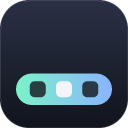
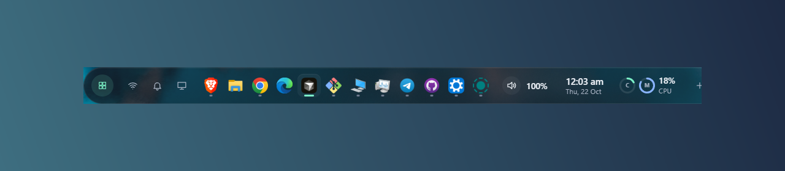

<div align="center">



# OpenDock

**The local-first smart dock you can read, extend and trust.**

OpenDock replaces the Windows taskbar with a dock that shows your apps and windows, live widgets and automations that act for you. It runs entirely on your PC: no account, no telemetry, no license keys.

[](https://github.com/isaacobenzy/OpenDock/actions/workflows/ci.yml)
[](https://github.com/isaacobenzy/OpenDock/releases)
[](LICENSE)
[](CONTRIBUTING.md)

[Website](https://opendock.pages.dev) · [Download](https://github.com/isaacobenzy/OpenDock/releases/latest) · [Documentation](docs/README.md) · [Roadmap](ROADMAP.md) · [Contributing](CONTRIBUTING.md)



</div>

---

## Highlights

- **A real taskbar replacement.** Pinned apps and every open window, grouped by app with live window previews. OpenDock reserves the screen edge so maximised windows never sit underneath it, and the Windows taskbar always comes back when OpenDock quits, crashes or is uninstalled.
- **Start launcher.** Instant search across installed apps, pinning, and lock, sleep, sign out, restart and shut down.
- **Fourteen built-in widgets.** Apps, Start, Volume, Quick actions, Clock, Now playing, Focus timer, Todos, Notes, Next event (iCal), System, Battery, Weather and Day progress. Each one renders in three sizes with proper loading, empty and error states.
- **Automation Studio.** Rules are plain data: *when* an event happens, *unless* a condition holds, *then* run actions. Ships with recipes such as Meeting mode, Sunset dark mode and Pause music for calls, plus dry runs, an activity log and Undo.
- **Privacy you can audit.** Every network request goes through one gate that only allows hosts a widget declared, and each request is written to a local Privacy Ledger you can inspect. Secrets live in the OS keychain.

## Install

1. Download `OpenDock_<version>_x64-setup.exe` from the [latest release](https://github.com/isaacobenzy/OpenDock/releases/latest).
2. Verify it against `SHA256SUMS.txt` from the same release (optional, recommended).
3. Run the installer. On first launch, OpenDock asks how it should treat the Windows taskbar.

Requirements: Windows 10 or 11, 64-bit, with the Microsoft Edge WebView2 runtime (preinstalled on Windows 11).

> [!NOTE]
> Pre-1.0 builds are not code-signed yet, so Windows SmartScreen may warn on first run. Choose **More info → Run anyway** after checking the checksum. Signed installers are a 1.0 goal; see the [roadmap](ROADMAP.md).

Full instructions, including uninstalling and recovering the taskbar: [docs/installation.md](docs/installation.md).

## Platform support

| Platform | Status |
| --- | --- |
| Windows 11 x64 | Supported |
| Windows 10 x64 | Supported, best effort |
| Linux | Planned (X11 and wlroots compositors first) |
| macOS | Planned |

Everything above the platform layer is shared, so Linux and macOS support is mostly a per-OS module plus packaging. See [ROADMAP.md](ROADMAP.md).

## Build from source

```powershell
git clone https://github.com/isaacobenzy/OpenDock.git
cd OpenDock
pnpm install
pnpm dev            # desktop app with hot reload
```

You need Node.js 20+, pnpm 9+, Rust stable (MSVC), and the Visual Studio 2022 Build Tools with the C++ workload. Step-by-step setup is in [docs/development.md](docs/development.md).

| Command | What it does |
| --- | --- |
| `pnpm dev` | Run the desktop app in development mode |
| `pnpm dev:web` | Run the website locally |
| `pnpm lint` / `pnpm typecheck` | ESLint and TypeScript across the workspace |
| `pnpm test` / `pnpm test:rust` | Vitest and Rust unit tests |
| `pnpm fmt:check` | Check Rust formatting |
| `pnpm build:desktop` | Release build of the desktop app without installers |
| `pnpm bundle:desktop` | Release build with NSIS and MSI installers |

## Repository layout

```
apps/desktop            Tauri 2 shell (Rust) and React UI
apps/web                Marketing and documentation website (Astro)
packages/config-schema  Shared Zod schemas, automation catalog and fixtures
docs/                   Architecture, guides and decision records
```

A tour of every module is in [docs/project-structure.md](docs/project-structure.md), and how they fit together is in [docs/architecture.md](docs/architecture.md).

## Contributing

Contributions of every size are welcome: bug reports, widgets, translations, docs and code. Start with [CONTRIBUTING.md](CONTRIBUTING.md), and look for issues labelled [`good first issue`](https://github.com/isaacobenzy/OpenDock/labels/good%20first%20issue). The engineering rules every change follows are in [AGENTS.md](AGENTS.md).

Please follow the [Code of Conduct](CODE_OF_CONDUCT.md). Report security issues privately as described in [SECURITY.md](SECURITY.md), not in public issues.

## License

[MIT](LICENSE) © OpenDock contributors.
