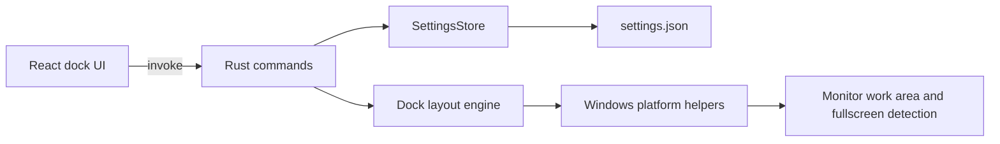

# Architecture (Milestone 2)

OpenDock uses a modular monorepo:

- `apps/desktop` — Tauri 2 shell and React UI
- `packages/config-schema` — shared Zod schemas for settings validation

## Runtime flow

## Boundaries

- Presentation lives in React (`features/dock`).
- Persistence and validation live in Rust (`settings`) with mirrored Zod schemas for the frontend.
- Platform-specific behavior is isolated under `platform/` with a `DockPlatform` trait entry point.
- Business logic is not embedded in presentational components; dock persistence goes through `services/ipc.ts`.

## Planned modules (not yet present)

- SQLite repositories and migrations (Milestone 4)
- Widget SDK and plugin host (Milestone 5)
- Automation engine registry (Milestone 5)
