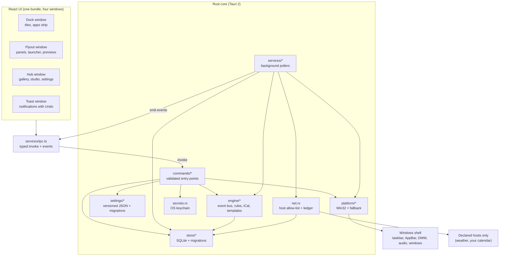

# Architecture

This document explains how OpenDock is put together: the processes and windows it runs, how data flows between the Rust core and the React UI, and where each responsibility lives. For a file-by-file tour, see [project-structure.md](project-structure.md). For the reasoning behind key choices, see the [decision records](adr/README.md).

## Goals that shape the design

- **Local-first.** Everything works offline and stays on the device. The network is opt-in per widget and audited.
- **Safe at the shell boundary.** OpenDock hides the taskbar and reserves a screen edge, so it must always be able to give them back.
- **Small, testable core.** Logic lives in plain Rust and TypeScript modules with unit tests; the UI only presents.
- **Portable by construction.** OS-specific code is isolated behind one module so Linux and macOS are additive.

## System overview



## Processes and windows

OpenDock is a single Tauri application. One frontend bundle serves four windows; `main.tsx` picks the root component from the window label.

| Window | Label | Purpose | Lifetime |
| --- | --- | --- | --- |
| Dock | `main` | The dock itself: tiles, apps strip, drag to reorder | Always running, transparent, always on top, skips the taskbar |
| Flyout | `flyout` | Panels above the dock: widget panels, Start launcher, app window previews, dock menu | Created on demand, hidden when it loses focus |
| Hub | `hub` | Widget gallery, Automation Studio, activity, settings, welcome setup | Opened from the dock menu or on first run |
| Toast | `toast` | Short notifications from automations, with Undo | Shown by the rule engine, auto-dismissed |

A second, short-lived process, the **taskbar guard**, is started whenever OpenDock hides the taskbar. It waits for the main process to exit and restores the taskbar from a marker file if the main process didn't do it itself, for example after a crash. The same executable also accepts `--restore-taskbar`, which the uninstaller calls.

`tauri-plugin-single-instance` makes a second launch focus the running dock instead of starting another one.

## Startup sequence

1. `main.rs` checks for the guard and restore flags and exits early if one is present.
2. `lib.rs` initialises logging, the single-instance and autostart plugins, and loads settings from `settings.json`, migrating and validating them. Invalid files are quarantined and replaced with defaults.
3. The SQLite database `opendock.db` is opened and migrated.
4. Shared state is registered: settings, database, event bus, automation engine, focus timer, window registry and the app catalog.
5. The dock is laid out on the chosen monitor and edge, and the taskbar mode is applied.
6. Background services start (see below), and the automation engine subscribes to the event bus.
7. If the user hasn't completed setup, the hub opens on the welcome page.

On exit, OpenDock clears window previews, releases the reserved screen edge and restores the taskbar before the process ends.

## Talking between UI and core

All communication goes through `apps/desktop/src/services/ipc.ts`, which wraps Tauri's `invoke` and event APIs with typed functions. Components never call Tauri directly.

- **Commands** (UI → core) are Rust functions in `commands/`. Each validates its input, limits sizes and acts only on known objects. For example, window actions only accept windows the enumerator has seen, and launches only accept pinned, installed or running apps.
- **Events** (core → UI) push live data: `system:stats`, `media:state`, `windows:changed`, `volume:state`, `weather:update`, `focus:state`, `settings:changed`, `data:changed` (a store table changed), `bus:event` (for the Studio's live view) and the fullscreen and window-control events. `services/live.tsx` loads initial values and keeps them current, exposing each as a `Loadable` (loading, ready or error) so every widget can render all three states.

### Permissions

Tauri capabilities grant each window only what it needs. Command groups are defined in `src-tauri/permissions/opendock.toml`, and every command must also be listed in `build.rs`.

| Permission set | Dock | Flyout | Hub | Toast |
| --- | :-: | :-: | :-: | :-: |
| `dock-core`, `navigation` | ✓ | ✓ | ✓ | navigation only |
| `widget-read`, `widget-control` | ✓ | ✓ | ✓ | |
| `apps-read` | ✓ | ✓ | ✓ | |
| `apps-control` (switch, launch, volume, shortcuts) | ✓ | ✓ | | |
| `previews`, `power` | | ✓ | | |
| `apps-setup`, `widget-config`, `automation` | | | ✓ | |

## Background services

`services/mod.rs` starts one thread per data source. Each samples on its own interval, emits UI events when the value changes, and publishes facts to the event bus.

| Service | Interval | Publishes |
| --- | --- | --- |
| System | 2 s | CPU, memory and battery stats; `system.cpu.sampled`, `system.battery.changed` |
| Media | 1.5 s | Now playing; `media.state.changed` |
| Windows | 450 ms | Open windows and the active one; `app.window.opened`, `app.window.focused` |
| Volume | 1 s | Output level and mute state |
| Fullscreen | 400 ms | Hides the dock during fullscreen apps; `system.fullscreen.changed` |
| Focus | 1 s | Focus timer progress; `focus.session.started`, `focus.session.ended` |
| Scheduler | to the next minute | `time.tick`, `sun.sunrise`, `sun.sunset` |
| Weather | 30 min, or on demand | Forecast from Open-Meteo; `weather.rain.soon` |
| Calendar | 15 min, or on demand | Upcoming events from iCal feeds; `calendar.event.starting` |

## Event bus and automations

The **event bus** (`engine/bus.rs`) is an in-process publish and subscribe channel. Every event has a namespaced name, a version, a timestamp, a source and a JSON payload. Each subscriber gets a bounded queue: a slow subscriber drops events rather than blocking publishers, and the drops are counted. Events can carry a dedupe key so a rule fires once per real-world occurrence.

**Rules are data, not code** ([ADR 0004](adr/0004-rules-are-data.md)):

```json
{
  "id": "meeting-mode",
  "name": "Meeting mode",
  "enabled": true,
  "when": { "event": "calendar.event.starting", "where": { "minutesUntil": { "lte": 5 } } },
  "unless": [{ "condition": "quietHours" }],
  "then": [
    { "action": "media.pause" },
    { "action": "toast.show", "text": "{{title}} in {{minutesUntil}} min", "undo": true }
  ],
  "cooldownMinutes": 10
}
```

The **rule engine** (`engine/rules.rs`) matches events against enabled rules, checks conditions and cooldowns, runs actions, and writes every run to the activity log so it can be reviewed and undone. Rule templates (`{{title}}`) are rendered by `engine/template.rs`. The available events, conditions, actions and recipes are declared once in `packages/config-schema/src/catalog.json`, which drives both the engine's validation and the Studio UI.

## Data and storage

| Data | Where | Format |
| --- | --- | --- |
| Settings | `%APPDATA%\com.opendock.app\settings.json` | Versioned JSON, validated by Rust types and Zod |
| Todos, notes, focus sessions, rules, activity, calendars and events, forecast cache, network log | `%APPDATA%\com.opendock.app\opendock.db` | SQLite with append-only migrations |
| Calendar feed links and other secrets | Windows Credential Manager, service `OpenDock` | OS keychain via the `keyring` crate |
| Taskbar restore marker | `%APPDATA%\com.opendock.app\taskbar-restore.json` | JSON written before the taskbar is hidden |

**Settings** carry a `version`. On load, older files are migrated step by step (the same migration exists in Rust and TypeScript), then validated. A file that fails validation is moved aside as `settings.invalid-<timestamp>.json` and defaults are used.

**The database** stores its schema version in `user_version`. Migrations are applied in order and never edited after release; a database from a newer build is refused rather than corrupted.

## Shared schemas

`packages/config-schema` holds the Zod schemas for settings and rules, their TypeScript types, migrations, and the automation catalog. The Rust core has mirrored types. Shared fixtures in `packages/config-schema/fixtures/` contain valid and invalid examples, and **both** test suites load them, so the two languages can't silently drift ([ADR 0002](adr/0002-shared-schemas-with-parity-fixtures.md)).

## Platform layer

All OS-specific code lives under `src-tauri/src/platform/`. `platform/mod.rs` exposes portable functions and types; on Windows they're backed by:

| Module | Responsibility |
| --- | --- |
| `win.rs` | Monitors and work areas, fullscreen detection, media sessions, system stats, theme, Start menu |
| `win_apps.rs` | Window enumeration, activation, minimise and close, app icons, shortcuts and launching, DWM thumbnails, AppBar edge reservation |
| `win_system.rs` | Audio endpoint volume and mute, keyboard shortcuts, lock, sleep and shutdown |
| `taskbar.rs` | Taskbar auto-hide and visibility, the restore marker and the guard process |

`fallback.rs` provides safe no-op or "unsupported" implementations for other platforms, so the rest of the code compiles and degrades gracefully. Adding Linux or macOS means writing a sibling module, not changing callers.

### Replacing the taskbar

In *Replace* mode ([ADR 0003](adr/0003-taskbar-replacement-with-guaranteed-restore.md)):

1. The current taskbar state is written to the restore marker, and the guard process is started.
2. The taskbar is hidden.
3. The dock registers as an **AppBar** on its screen edge, so Windows shrinks the work area and maximised windows stop at the dock.
4. The dock is laid out against the full monitor rectangle, inside the reserved band.

The edge is released and the taskbar restored on quit, on power actions (sign out, restart, shut down), on panic, by the guard after a crash, and by the uninstaller.

## Network and privacy

`net.rs` is the only HTTP client. Every request names the hosts it's allowed to reach; anything else is rejected before a connection is made. Responses are size-limited. Each request is recorded in the `network_log` table, which the hub shows as the **Privacy Ledger**. Today the only hosts contacted are Open-Meteo (weather and city search, when the weather widget is configured) and the calendar hosts the user adds. See [security.md](security.md).

## Frontend structure

The UI is organised by feature under `apps/desktop/src/features/`. Each feature keeps its presentational components, its pure model (with tests) and its CSS together.

- `dock/` — the dock bar, drag to reorder, click handling
- `widgets/` — the widget catalog, dock tiles, icons and shared visuals
- `apps/` — the apps strip, tray and volume tiles, and the app model
- `flyout/` — the flyout root and every panel
- `hub/` — hub pages, Automation Studio and the welcome flow
- `toast/` — the toast window and its queue

Global styles live in `styles/`: `tokens.css` holds every colour, radius, shadow and motion value, and `base.css` holds shared primitives. Feature CSS uses tokens only.
